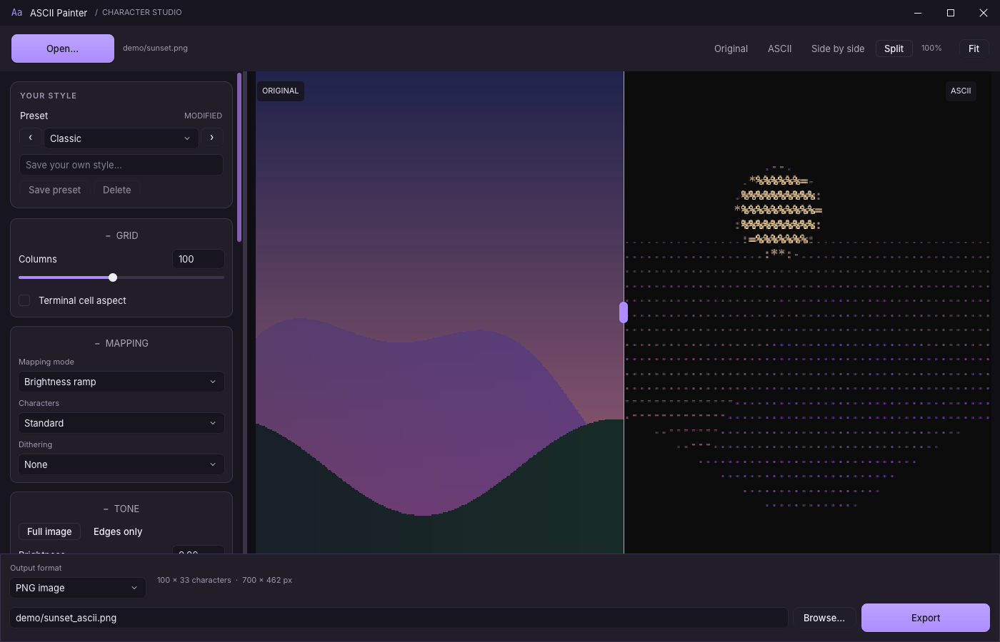

<div align="center">

# ASCII Painter

**Turn images and videos into high-quality ASCII art.**<br>
Live preview, before/after and split view, presets, PNG / MP4 / TXT / ANSI export

[](https://www.rust-lang.org)
[](https://github.com/anomalyco/rune)
[](#build-from-source)
[](#bundled-ffmpeg)
[](#licences)



</div>

---

## Features

| | |
|---|---|
| **Mapping modes** | Brightness ramp, **shape matching** (picks the glyph whose strokes match the image structure), half blocks `▀▄`, quadrant blocks `▚`, braille `⣿` |
| **Tone** | Brightness, contrast, gamma, saturation, levels (black / white point, shadows, highlights) or **auto levels**, edge-preserving denoise, sharpen, edge boost, invert, edges-only line art |
| **Dithering** | Floyd-Steinberg, Atkinson, Bayer 4x4 / 8x8, blue noise (Bayer and blue noise are stable across video frames) |
| **Colour** | Mono, colour text, colour text + background; true colour, ANSI 256 / 16 or a custom palette; **chroma key** (green screen) and transparent-background PNG / WebP |
| **Video** | Temporal stability (glyph hysteresis, colour smoothing), trimming, audio kept in MP4, rotated / anamorphic sources handled |
| **Compare** | Original, ASCII, side-by-side and a draggable **split view**, with shared zoom and pan |
| **Interface** | Rune / Rune Kit, dark violet theme, large Open / Export controls, accent scrollbar, resizable settings panel and custom Windows / Linux titlebars |
| **Export** | PNG, MP4 (H.264 / AAC), plain `.txt`, ANSI `.ans`, with progress, ETA and cancel |
| **Presets** | 22 built-in (Classic, Detailed, Line Art, Game Boy LCD, ANSI 16 Terminal, Synthwave Poster, Green Screen, ...) plus your own, saved as TOML |

The preview uses the exact same renderer as the export, so what you see is what you get.

## Using it

Unpack the release archive and run `ascii-painter` (`ascii-painter.exe`). No separate ffmpeg installation is needed.

1. **Open** or drop an image / video (or pass it as an argument).
2. Pick a **preset** and fine-tune the settings; the preview updates live.
3. Compare in **Split** view: drag the divider, scroll to zoom, drag to pan, double-click to fit.
4. Hit **Export**.

### Command line

`ascii-painter-cli` sits next to the app:

```sh
ascii-painter-cli convert photo.jpg -o photo.png --preset "Colour Shapes" --cols 200
ascii-painter-cli convert clip.mp4 -o clip_ascii.mp4 --preset "Video Stable" --start 5 --end 15
ascii-painter-cli play clip.mp4          # plays in the terminal; q / Esc to stop
ascii-painter-cli presets
```

The output format follows the extension: `.png/.jpg/.webp/.bmp`, `.mp4`, `.txt`, `.ans`.
Video `.txt` frames are separated by form feeds; video `.ans` files play with `ascii-painter-cli play`.
With *transparent background* on, `.png` and `.webp` keep alpha; `.jpg`, `.bmp` and `.mp4` are composited onto the background colour.
`--settings file.toml` loads a settings file.

User presets are TOML files in the platform config folder (`.../ASCII Painter/presets`).

Application preferences use versioned `preferences.json` in the same config folder. On the first
Rune launch, previous application settings and normal/maximized/fullscreen window geometry are
imported from `app.ron` when present; that file and preset files are left untouched. Corrupt or newer
JSON preferences produce a visible warning and are not overwritten. Exporting over an existing file
requires confirmation; conversion writes an adjacent staging file and replaces the destination only
after success. A destination changed during the export must be confirmed again.

## Build from source

The checked-in toolchain pins Rust 1.99.1. Rune is pinned to one upstream revision; the small,
vendored native-window patch is described in [`vendor/rune/UPSTREAM.md`](vendor/rune/UPSTREAM.md).
Linux requires a Vulkan-capable GPU/driver, X11 or Wayland, and the desktop file chooser portal
(`xdg-desktop-portal` plus a backend such as GTK, KDE or GNOME). See `build.sh` for system packages.
Tested configurations, dated evidence and remaining desktop / ARM64 acceptance gates are recorded in
[`docs/rune-validation.md`](docs/rune-validation.md).

```sh
cargo run -p ascii-painter-gui            # GUI (uses ffmpeg from PATH during development)
cargo run -p ascii-painter-cli -- --help
cargo test --workspace                    # video tests are skipped if ffmpeg is not on PATH
```

### Release builds

```sh
.\build.ps1      # Windows -> dist\ascii-painter-windows-x64.zip
./build.sh       # Linux   -> dist/ascii-painter-linux-<x64|arm64>.tar.gz
```

Each script builds for the machine it runs on and produces a portable folder (and archive) with the GUI,
the CLI and a pinned, checksum-verified ffmpeg / ffprobe next to them. On Linux the GUI needs the usual
system libraries (see the header of `build.sh`).

> **Windows note:** security software that intercepts new executables (e.g. Norton Data Protector) can make
> cargo fail with *"failed to link or copy ... build-script-build.exe ... Access denied"*. Exclude the
> repository's `target` folder from it. Paths it already blocked can stay blocked after that, which is why
> `build.ps1` builds into `target\package`; set `CARGO_TARGET_DIR` to build somewhere else.

## Project layout

| Crate | Purpose |
|---|---|
| `crates/core` | Conversion library: tone, dithering, glyph matching, colour, renderers (no UI, no ffmpeg) |
| `crates/video` | ffmpeg discovery, probe, decode / encode pipes and the export pipeline |
| `crates/gui` | Rune / Rune Kit application (`ascii-painter`), owned media jobs and image compositor |
| `crates/cli` | Command-line tool (`ascii-painter-cli`) |
| `vendor/rune` | Pinned Rune core with custom Windows / Linux window support |

## Limitations

- HDR video is converted without tone mapping and may look washed out (the app warns).
- `.txt` export drops colour.

## Bundled ffmpeg

Releases ship unmodified static builds of ffmpeg 9.0.2 as a separate program (GPL, includes libx264); ASCII Painter
runs it as a child process. See [`LICENSES/ffmpeg-NOTICE.txt`](LICENSES/ffmpeg-NOTICE.txt) for the exact builds and source links.

## Licences

ASCII Painter: MIT OR Apache-2.0. Bundled font: DejaVu Sans Mono ([`LICENSES/DejaVu-LICENSE.txt`](LICENSES/DejaVu-LICENSE.txt)).

Rune / Rune Kit: MIT. Inter and IBM Plex Mono: SIL Open Font License. See
[`LICENSES/Rune-NOTICE.txt`](LICENSES/Rune-NOTICE.txt) and the accompanying license texts.
